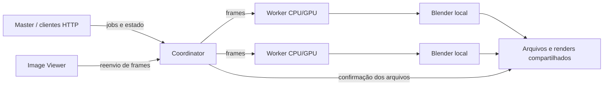

# Blender Render Farm

Uma render farm local para Blender, com fila central, workers CPU/GPU e interfaces desktop para Windows. Distribua frames entre computadores da sua rede, acompanhe os trabalhos e retome frames pendentes após interrupções.

**Gratuito para finalidades não comerciais.** O código de gerenciamento usa a [PolyForm Noncommercial 1.0.0](LICENSE). Não é permitido usar esse código para operar uma render farm comercial, vender renderização ou oferecer um serviço pago derivado. Consulte o [guia de licenciamento](docs/LICENSING.md) para o escopo e as exceções de terceiros.

[English quick start](README.en.md) · [Instalação](docs/INSTALLATION.md) · [Configuração](docs/CONFIGURATION.md) · [API](docs/API.md) · [Desenvolvimento](docs/DEVELOPMENT.md)

## O que está incluído

| Componente | Função | Diretório |
| --- | --- | --- |
| **Coordinator** | Mantém a fila global, o banco SQLite e a distribuição de frames | `coordinator/blender_render_farm_coordinator` |
| **Master** | Interface para enviar trabalhos e acompanhar a farm | `master/blender_render_farm_master` |
| **Worker** | Executa o Blender instalado na máquina e informa o progresso | `worker/blender_render_farm_worker` |
| **Image Viewer** | Visualiza imagens renderizadas e permite reenviar grupos de frames | `image_viewer/BlenderImageViewer` |
| **Shared** | Traduções e componentes de apresentação compartilhados | `shared/renderfarm_shared` |



O modo `coordinator` aceita vários Masters e executa um job por vez em ordem FIFO, distribuindo seus frames entre os workers. O Master também possui modo `direct`, com agendamento local e sem Coordinator.

## Recursos

- Descoberta do Coordinator na LAN por UDP e cadastro de workers.
- Seleção de CPU/GPU por worker e roteamento por versão do Blender.
- Validação dos caminhos antes da renderização.
- Recuperação de frames e confirmação do progresso pelos arquivos de saída.
- Sessão persistente do Blender opcional, desativada por padrão.
- Interfaces em português, inglês e espanhol; API REST com OpenAPI.

## Começar no Windows

Use **Python 3.11 ou 3.12 de 64 bits**, com Tcl/Tk, e instale o Blender separadamente em cada worker. A publicação foi validada com Python 3.12; consulte [os resultados de validação](docs/VALIDATION.md). Mantenha a estrutura completa do repositório, pois os aplicativos usam `shared/`.

```powershell
git clone https://github.com/Vinicruznxd/blender-render-farm.git
cd blender-render-farm
py -3.12 -m venv .venv
.\.venv\Scripts\python.exe -m pip install -r requirements-dev.txt
```

Copie as configurações de exemplo **uma vez**, antes do primeiro uso:

```powershell
Copy-Item coordinator/blender_render_farm_coordinator/config.example.json coordinator/blender_render_farm_coordinator/config.json
Copy-Item worker/blender_render_farm_worker/config.example.json worker/blender_render_farm_worker/config.json
Copy-Item master/blender_render_farm_master/config.example.json master/blender_render_farm_master/config.json
Copy-Item image_viewer/BlenderImageViewer/config.example.json image_viewer/BlenderImageViewer/config.json
```

Em terminais separados, abertos na raiz do repositório:

```powershell
# Um Coordinator para a rede
.\.venv\Scripts\python.exe coordinator/blender_render_farm_coordinator/main.py

# Um Worker em cada computador que fará o render
.\.venv\Scripts\python.exe worker/blender_render_farm_worker/worker.py

# Interface de envio e acompanhamento
.\.venv\Scripts\python.exe master/blender_render_farm_master/main.py

# Visualizador opcional
.\.venv\Scripts\python.exe image_viewer/BlenderImageViewer/main.py
```

No Master, selecione um `.blend`, a pasta de saída e um intervalo pequeno de frames. Confirme que todos os workers e o Coordinator acessam os mesmos caminhos. Prefira caminhos UNC, como `\\servidor\render\cena.blend`, para uma farm com várias máquinas. O sistema envia referências aos arquivos; não envia automaticamente as cenas e texturas aos workers.

Os exemplos escutam apenas em `127.0.0.1` e desativam descoberta para começar localmente. Para usar várias máquinas, ajuste os endereços e a descoberta conforme o [guia de instalação](docs/INSTALLATION.md#usar-várias-máquinas-na-lan).

## Limites operacionais

Esta versão foi projetada para máquinas e usuários confiáveis em uma rede privada. O Coordinator não implementa autenticação nem TLS; não o exponha diretamente à internet. O token opcional do Worker ainda não é propagado pelos clientes Master/Coordinator. Veja [SECURITY.md](SECURITY.md).

Os testes automatizados usam mocks para a renderização. Valide sua combinação de Blender, drivers, GPU, cenas e compartilhamentos antes de enviar uma fila longa. Linux e macOS não são plataformas validadas nesta publicação.

## Documentação e contribuição

- [Instalar, iniciar e fazer o primeiro render](docs/INSTALLATION.md)
- [Configurar rede, GPU e persistência](docs/CONFIGURATION.md)
- [Integrar pela API](docs/API.md)
- [Arquitetura e pontos de extensão](docs/ARCHITECTURE.md)
- [Executar testes e gerar pacotes](docs/DEVELOPMENT.md)
- [Diagnosticar problemas](docs/TROUBLESHOOTING.md)
- [Contribuir com código e documentação](CONTRIBUTING.md)
- [Licenças e usos permitidos](docs/LICENSING.md)

Projeto independente de **Vinicius D'Arcadia Cruz** ([Vinicruznxd](https://github.com/Vinicruznxd)). Não é um produto oficial da Blender Foundation. Blender e os componentes de terceiros conservam suas próprias licenças e marcas.
